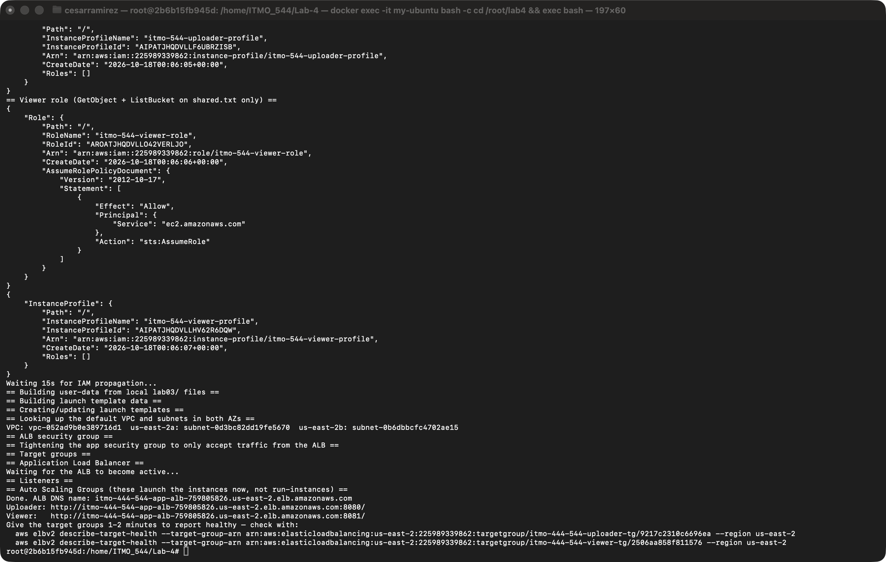
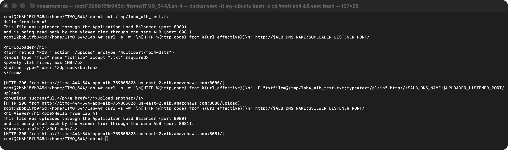
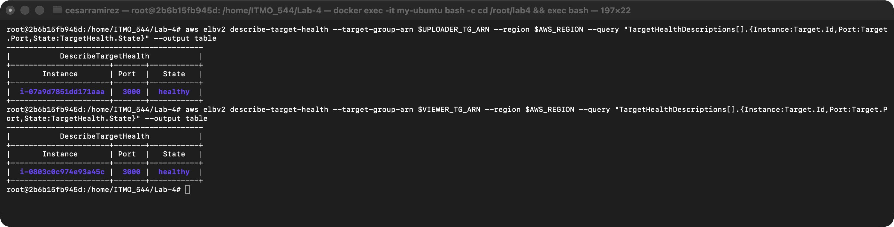
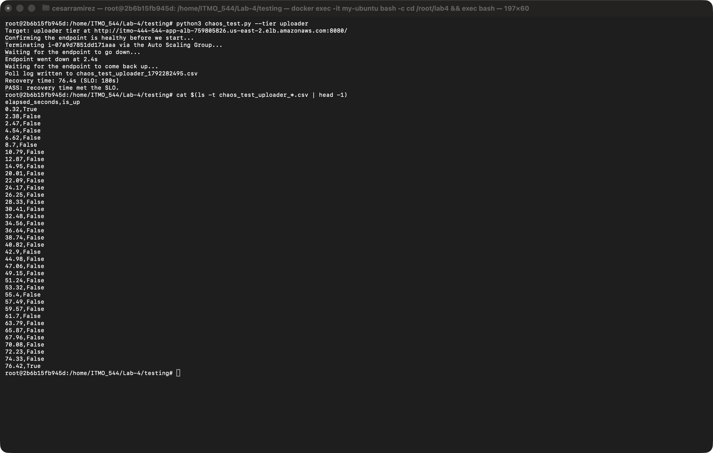
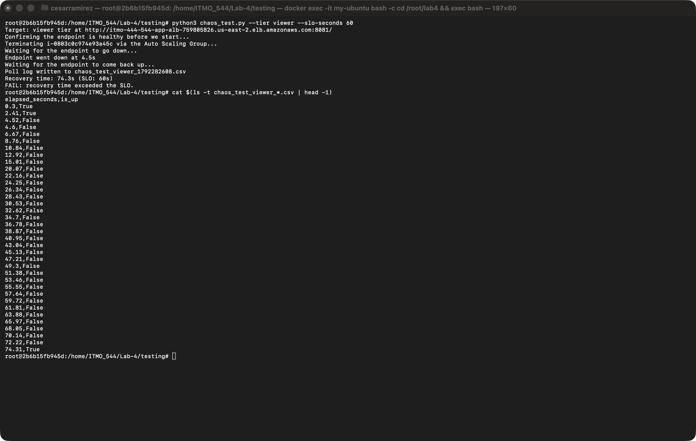
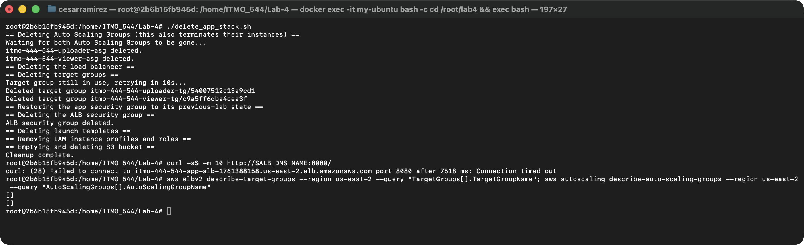

# Multi-AZ Resilience: ALB, Auto Scaling Groups, and Recovery-Time SLOs

## (1) Screenshot of create_app_stack.sh completing, showing both http://<alb-dns>:port/ URLs.

## (2) Screenshot of both apps working through the ALB (uploader upload confirmation, viewer showing content).

## (3) Screenshot of aws elbv2 describe-target-health showing both target groups healthy.

## (4) The CSV poll log and console output from a chaos_test.py run that passed its SLO.

Uploader tier, default SLO of 180s: recovered in 76.4s, **PASS**.

CSV log: [chaos_test_uploader_1792282495.csv](./testing/chaos_test_uploader_1792282495.csv)

## (5) The CSV poll log and console output from a run that failed a tightened SLO.

Viewer tier, SLO tightened to 60s: recovered in 74.3s, **FAIL**.

CSV log: [chaos_test_viewer_1792282608.csv](./testing/chaos_test_viewer_1792282608.csv)

Between the two runs, the infrastructure stayed the same and recovery took about the same time (76.4s vs 74.3s). The only thing that changed was the SLO. At 180s there was plenty of headroom, but at 60s the same ~75s recovery is over budget, so the run fails.

## (6) One paragraph explaining, using your own recovery-time numbers, what dominates the recovery window.

In my runs, both tiers recovered in about 75 seconds (76.4s for the uploader and 74.3s for the viewer). The ALB stopped serving traffic within a few seconds of the termination, and the Auto Scaling Group launched a replacement in under 10 seconds, so detecting the failure was not the slow part. Most of the recovery window was the new instance booting and running its user-data script to install Node.js and the app's dependencies, with the health checks adding a small amount on top. A pre-baked AMI or a second standby instance would be the best way to bring recovery under a tighter SLO like 60 seconds.

## (7) One paragraph explaining what changed in create_app_stack.sh / delete_app_stack.sh between the previous lab and this one.

The bucket, IAM role, and launch template logic stayed the same as the previous lab, but the run-instances block that launched the uploader and viewer directly was removed. It was replaced by an Application Load Balancer, two target groups, and two Auto Scaling Groups that launch the instances from the same launch templates. The reason for this change is that run-instances only launches an instance once, while an Auto Scaling Group keeps one instance running at all times and automatically replaces it if it is terminated or fails a health check. The delete script now removes this new layer first before running the same IAM and S3 cleanup from the previous lab.

## (8) Screenshot of delete_app_stack.sh completing with no errors.

