# Infrastructure as Python: From AWS CLI and Bash to boto3 and pytest

This lab rebuilds the Lab-4 stack (S3, IAM, launch templates, ALB, target groups, Auto Scaling Groups) as a Python package (`stack/`) using boto3, and tests it on three layers: unit tests against a fake AWS (moto), integration tests against the real stack, and a chaos test that terminates instances and checks recovery against the SLO.

The raw terminal output for every step is saved in [`results/`](./results).

## (1) ls -a Lab-5

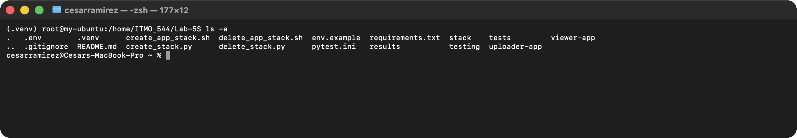

## (2) Screenshot of pytest showing 19 passed

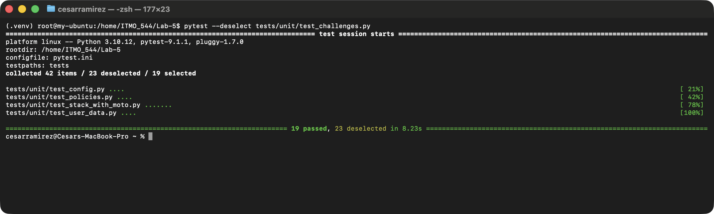

## (3) Screenshot of one "break it on purpose" experiment: the changed line and the failing test message.

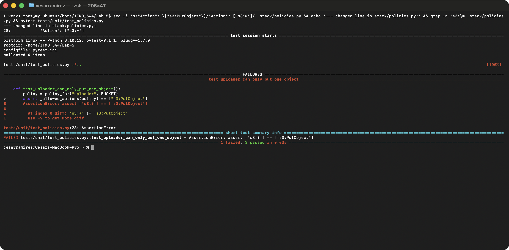
All three experiments fail the test, and passed again after reverting.

## (4) Screenshot of python create_stack.py completing, with both URLs.

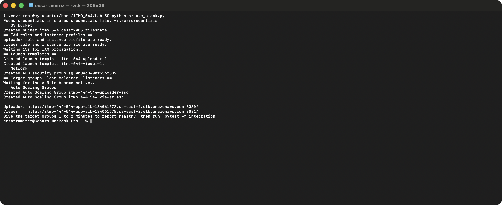

## (5) Screenshot of pytest -m integration -v with all 14 tests passing.

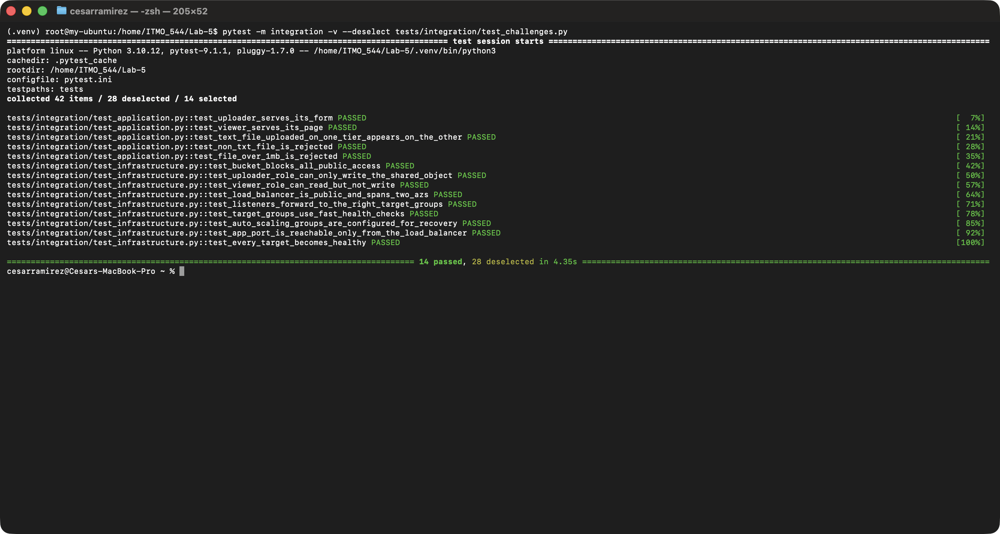

## (6) Output of pytest -m chaos -s for both tiers, and the same run failing after you tightened the SLO.

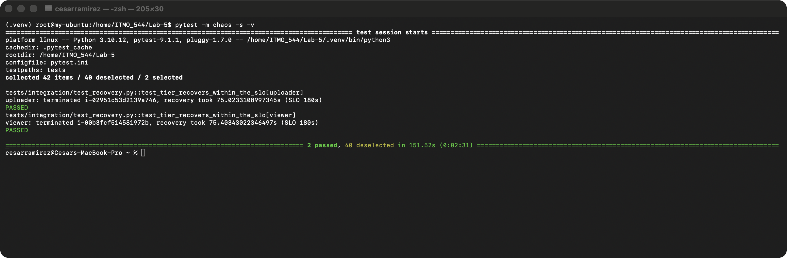

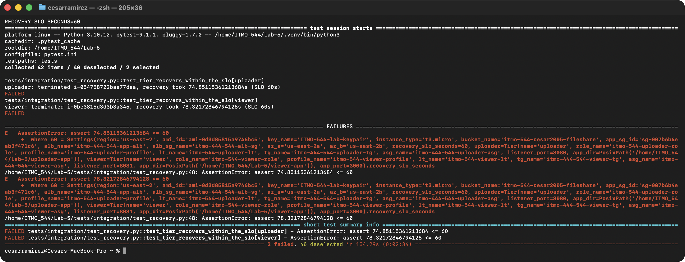

## (7) Screenshot of python delete_stack.py completing, and a second run completing with no errors.

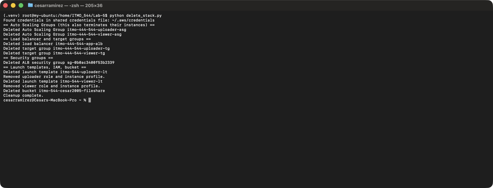

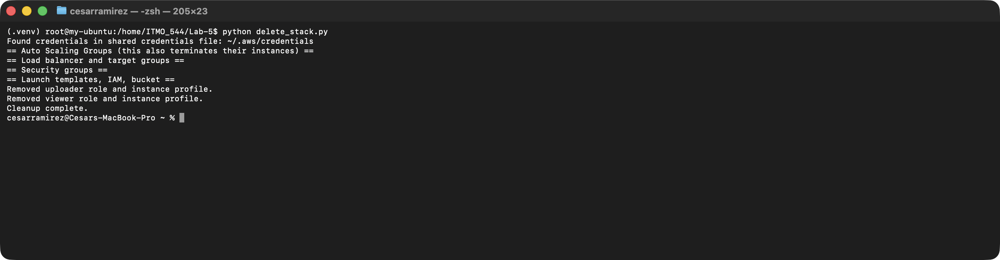

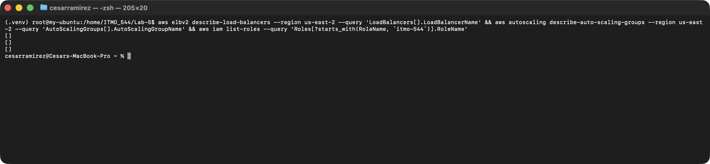

## (8) One paragraph on what moto proved, what it could not, and which tests cover the gap.

Moto proved that my create and delete code calls the AWS APIs with valid parameters in the right order, every resource gets created with the configuration I intended, running create twice doesn't duplicate anything, and delete is safe to run twice, even when an extra managed policy is attached to a role. All of that ran in about 8 seconds with no AWS account. What moto can't prove is anything that depends on real AWS, whether the instances actually boot, whether `npm install` works, whether the app answers HTTP through the ALB, and whether IAM really allows and denies what the policy text says. The integration tests cover that gap. `test_every_target_becomes_healthy` and `test_application.py` prove the apps boot and work end to end. The two `simulate_principal_policy` tests ask AWS itself what each role can do. The chaos test proves the ASG actually replaces a terminated instance within the SLO.

## (9) One paragraph comparing ignore_errors("EntityAlreadyExists") with 2>/dev/null || true.

`2>/dev/null || true` hides every possible failure, not just one. If `create-role` failed because of a typo in the policy JSON, a missing IAM permission, or an expired session, the bash script would carry on as if nothing happened and break later with a confusing error. `ignore_errors("EntityAlreadyExists")` only swallows the one error code that means "this role is already there, which is fine." Any other `ClientError` still gets raised and stops the script right where the real problem is.

## Part J: Challenges

1. **Tags test.** An integration test checks that the latest launch template version on the real stack tags every instance `Name=uploader-app` or `Name=viewer-app` (passed for both tiers). There's a matching moto unit test.

2. **A failing path.** `Settings.from_values` used to raise a bare `ValueError: invalid literal for int()` when `RECOVERY_SLO_SECONDS=fast`. `config.py` now converts numbers through `_int_setting()`, which raises `ConfigError: RECOVERY_SLO_SECONDS must be a whole number, got 'fast'`. The test is `test_non_numeric_slo_gives_a_clear_config_error`.

3. **Dry run.** The pure functions (`build_user_data`, `launch_template_data`, `policy_for`, `trust_policy`, and the `Settings` code) can stay unchanged, because they never call AWS. Every `ensure_*`/`delete_*` function would need either a `dry_run` parameter, or (cleaner) `create_stack` could be handed a fake `AwsClients` whose methods log the call and its arguments instead of sending it. That way none of the step functions change.

4. **Drift check.** `test_ssh_is_not_open_to_the_world` **failed on my real stack**: the app security group from Lab-3 has `tcp 22 from 0.0.0.0/0`. That's exactly the kind of drift the test is meant to catch. A daily run would give a team an automatic alarm when someone opens a port by hand in the console, instead of finding out during an audit or after an incident.
   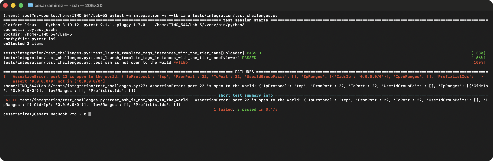
   
5. **Reflect.** The bucket step is shorter in bash: one `if aws s3api head-bucket ... 2>/dev/null` line versus a `try/except` that checks the error code. The extra Python lines tell a 404 ("free to create") apart from a 403 ("someone else owns this name"), so a name collision stops with a clear error instead of falling through to a confusing `create-bucket` failure.
